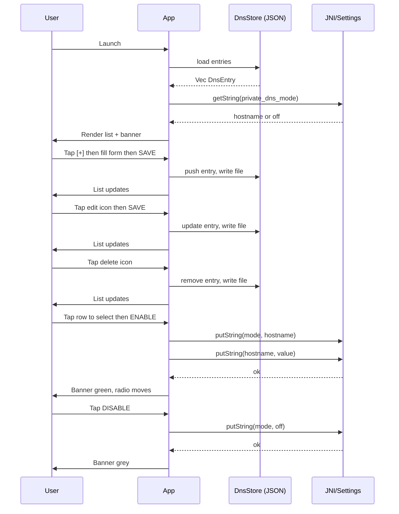
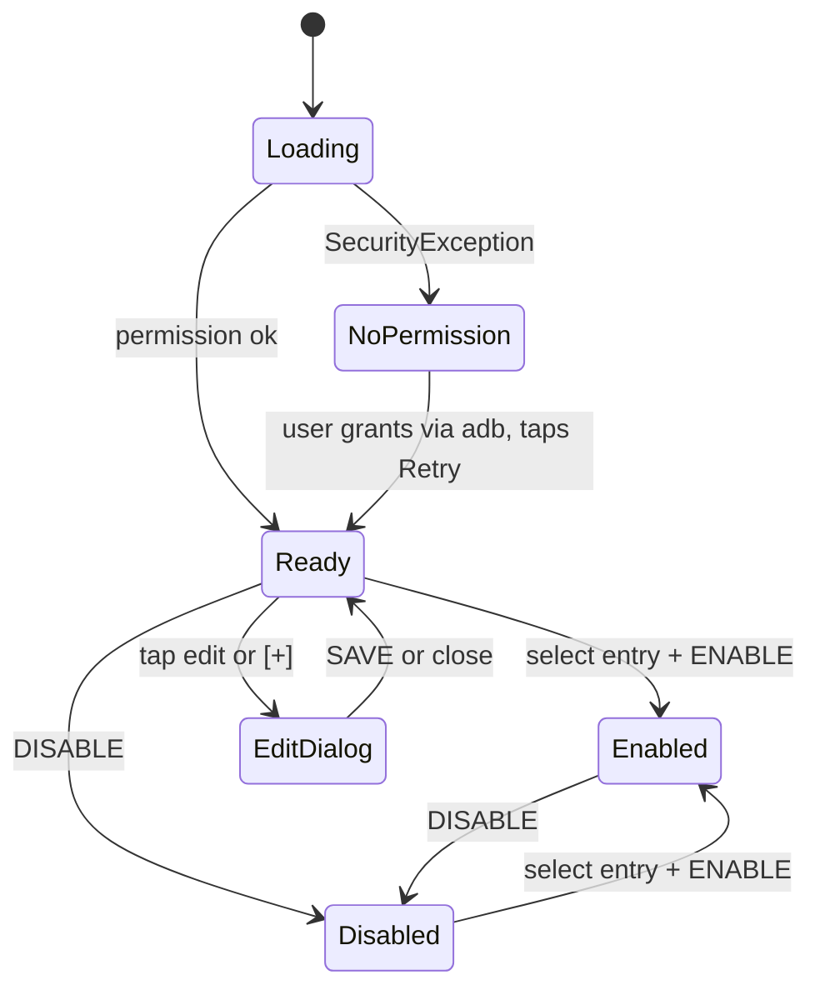

# UI Sketch — Private DNS Switcher

Single screen, mobile-first, dark theme by default. User manages a list of DNS entries (add / edit / delete), selects one, and toggles private DNS on/off.

## Layout (portrait, ~360×780 dp)

```
┌─────────────────────────────────────┐
│  Private DNS                    [+] │  ← header + add button
├─────────────────────────────────────┤
│                                     │
│  ┌─────────────────────────────┐    │
│  │  ● Enabled — dns.quad9.net  │    │  ← status banner (green/red/grey)
│  └─────────────────────────────┘    │
│                                     │
│  ── Saved DNS Entries ──            │
│  ┌─────────────────────────────┐    │
│  │ ● Quad9                     │    │  ← active (radio filled)
│  │   dns.quad9.net       ✎ 🗑 │    │
│  ├─────────────────────────────┤    │
│  │ ○ Google                    │    │
│  │   dns.google          ✎ 🗑 │    │
│  ├─────────────────────────────┤    │
│  │ ○ Cloudflare                │    │
│  │   1dot1dot1dot1...    ✎ 🗑 │    │
│  └─────────────────────────────┘    │
│                                     │
│  ┌─────────────────────────────┐    │
│  │       [ ENABLE DNS ]        │    │  ← primary (green, filled)
│  └─────────────────────────────┘    │
│  ┌─────────────────────────────┐    │
│  │       [ DISABLE DNS ]       │    │  ← secondary (red, outlined)
│  └─────────────────────────────┘    │
│                                     │
└─────────────────────────────────────┘
```

## Add / Edit Dialog (overlay)

```
┌─────────────────────────────────────┐
│  Add DNS Entry               [✕]   │
├─────────────────────────────────────┤
│                                     │
│  Name                               │
│  ┌─────────────────────────────┐    │
│  │ Quad9                       │    │
│  └─────────────────────────────┘    │
│                                     │
│  Hostname                           │
│  ┌─────────────────────────────┐    │
│  │ dns.quad9.net               │    │
│  └─────────────────────────────┘    │
│                                     │
│  ┌─────────────────────────────┐    │
│  │         [ SAVE ]            │    │
│  └─────────────────────────────┘    │
│                                     │
└─────────────────────────────────────┘
```

Same dialog for edit, pre-filled with existing values. Delete is immediate (one tap 🗑, entry gone — no confirm dialog for a utility app).

## Permission-denied state

```
┌─────────────────────────────────────┐
│  Private DNS                    [+] │
├─────────────────────────────────────┤
│                                     │
│  ┌─────────────────────────────┐    │
│  │  ⚠ Permission required      │    │  ← yellow/red banner
│  └─────────────────────────────┘    │
│                                     │
│  This app needs WRITE_SECURE_       │
│  SETTINGS. Grant it once via ADB:   │
│                                     │
│  ┌─────────────────────────────┐    │
│  │ adb shell pm grant \        │    │  ← monospace, selectable
│  │   com.sicloud.dnsswitcher \ │    │
│  │   android.permission.\      │    │
│  │   WRITE_SECURE_SETTINGS     │    │
│  └─────────────────────────────┘    │
│                                     │
│         ┌───────────────────┐       │
│         │      RETRY        │       │
│         └───────────────────┘       │
│                                     │
└─────────────────────────────────────┘
```

## Interaction flow



## State



## Component tree

```
App
└── HomeScreen
    ├── StatusBanner { mode, hostname, permitted }
    ├── DnsList
    │   └── DnsEntryRow × N { entry, active, on_select, on_edit, on_delete }
    ├── AddButton [+]
    ├── EnableButton
    ├── DisableButton
    ├── EditDialog { visible, entry, on_save, on_close }
    └── PermissionBlock { visible, adb_command }
```

## Data flow

```
App start
  │
  ├─► dns_store::load() → Vec<DnsEntry> from local JSON
  │     (seed defaults on first run: Quad9, Google, Cloudflare)
  │
  ├─► dns::get_private_dns()
  │     ├─► Ok(mode, hostname) → permitted = true, match active entry
  │     └─► SecurityException → permitted = false
  │
  ├─► Render HomeScreen with list
  │
  ├─► User taps [+] / ✎ → EditDialog
  │     └─► SAVE → dns_store::save(entries)
  │
  ├─► User taps 🗑 → remove from list → dns_store::save(entries)
  │
  └─► User selects row + taps ENABLE/DISABLE
        │
        ├─► dns::set_private_dns(entry.hostname) or set_private_dns(None)
        │     ├─► Success → update banner, radio dot
        │     └─► SecurityException → show permission block
        │
        └─► State persists (Android Settings.Global is system-wide)
```

## Persistence

`dns_store.rs` reads/writes a JSON file at the app's internal storage dir:

```rust
// models/dns_entry.rs
#[derive(Serialize, Deserialize, Clone)]
pub struct DnsEntry {
    pub id: u64,
    pub name: String,
    pub hostname: String,
}

// services/dns_store.rs
const FILE: &str = "dns_entries.json";

pub fn load(ctx: &Context) -> Vec<DnsEntry> { /* read file, or seed defaults */ }
pub fn save(ctx: &Context, entries: &[DnsEntry]) { /* write JSON */ }
```

Defaults seeded on first launch:

| Name | Hostname |
|---|---|
| Quad9 | dns.quad9.net |
| Google | dns.google |
| Cloudflare | 1dot1dot1dot1.cloudflare-dns.com |

## CSS sketch (`assets/styles/main.css`)

```css
:root {
  --bg: #1a1a2e;
  --surface: #16213e;
  --accent: #0f3460;
  --green: #4ecca3;
  --red: #e94560;
  --text: #eaeaea;
  --mono: "JetBrains Mono", monospace;
}

body {
  margin: 0;
  font-family: system-ui, sans-serif;
  background: var(--bg);
  color: var(--text);
}

.container { max-width: 400px; margin: 0 auto; padding: 24px 16px; }

.banner { border-radius: 12px; padding: 16px; margin-bottom: 24px; }
.banner--active { background: color-mix(in srgb, var(--green) 15%, transparent); border-left: 4px solid var(--green); }
.banner--off    { background: var(--surface); border-left: 4px solid #666; }
.banner--denied { background: color-mix(in srgb, var(--red) 10%, transparent); border-left: 4px solid var(--red); }

.dns-list { display: flex; flex-direction: column; gap: 8px; margin-bottom: 24px; }
.dns-row { display: flex; align-items: center; padding: 12px; border-radius: 8px; background: var(--surface); }
.dns-row--active { border: 1px solid var(--green); }
.dns-row .actions { margin-left: auto; display: flex; gap: 8px; }

.btn-primary { width: 100%; padding: 14px; border-radius: 10px; border: none; font-size: 16px; font-weight: 600; cursor: pointer; }
.btn-enable  { background: var(--green); color: #000; }
.btn-disable { background: var(--red); color: #fff; }

.dialog-overlay { position: fixed; inset: 0; background: rgba(0,0,0,0.6); display: flex; align-items: center; justify-content: center; }
.dialog { background: var(--surface); border-radius: 12px; padding: 24px; width: 90%; max-width: 360px; }
.dialog input { width: 100%; padding: 12px; border-radius: 8px; border: 1px solid var(--accent); background: var(--bg); color: var(--text); margin-bottom: 12px; }

.adb-command { font-family: var(--mono); font-size: 13px; background: var(--surface); padding: 12px; border-radius: 8px; white-space: pre-wrap; user-select: all; }
```